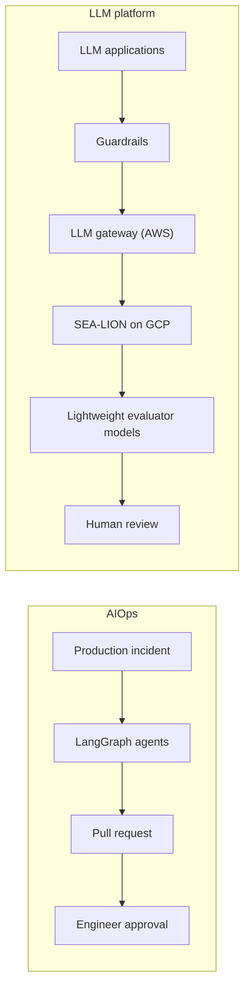

# Hi, I'm Shankar Saran Singh

**Staff Engineer, AIOps at SPH Media · Hands-on AI & Data Architect** 
Agentic AI · LLM / RAG platforms · Real-time recommender systems · MLOps

---

## About me

I've spent 14 years building data and AI systems, the last 7+ at SPH Media in Singapore, where I went from Senior Technical Lead to Staff Engineer. The systems I work on are used by newsrooms such as The Straits Times, The Business Times, Berita Harian and Tamil Murasu.

Most of my time (roughly 80%) is hands-on: designing systems, writing code, debugging and keeping things running in production. The rest goes into helping a team of up to 18 engineers get unblocked, reviewing designs and code, and mentoring juniors.

I'm **open to Principal Engineer and Architect roles**.

Most of my code lives in SPH's internal GitHub, so this profile is an overview of my work rather than a code portfolio.

## What I'm working on now

- **Newsroom AI tools.** An AI editor that journalists across SPH's major titles use to draft articles with the right background and context, and a chatbot used by SPH's Chinese-language publications.
- **Agentic incident remediation.** Directed LangGraph workflows where agents work through a production incident, draft a fix and open a pull request. An engineer approves every PR before it merges.
- **Self-hosted LLM.** AI Singapore's `Qwen-SEA-LION-v4.5-27B-IT`, deployed in-house on GCP and served to applications through our AWS LLM gateway. We hosted it ourselves because no managed API existed at the time, no SLA was on offer, and data governance and privacy rules required data to stay in-house.
- **Fact-checking (RAG).** A system that retrieves evidence and checks claims against it, meant to be shared across teams.
- **AI citation for newsrooms.** Tracking how AI answer engines such as ChatGPT, Google AI Overviews and Perplexity cite our journalism.
- **Post-campaign reports.** Rule-based report generation for advertising campaigns, with an LLM layer that adapts each report on the fly because every campaign has different parameters.
- **Data platform support.** Architecture support for the data team's pipelines, including the ongoing migration from the data lake to the data warehouse.
- **Guardrails and evaluation.** Prompt-injection checks, PII redaction, grounding checks and output schema validation. Lightweight models score responses first, and a human reviewer makes the final call.

## Things I've built before

- **Real-time recommendation platform** for SPH's news and ad products, serving millions of users on AWS EKS. It runs self-hosted open-source models (NRMS, SBERT MPNet and multilingual sentence embeddings) with OpenSearch vector search and a reranker we built in-house.
- **Batch and streaming data platform** on Spark, PySpark, Kafka and Airflow, processing millions of transactions a day. Reworking the backfill jobs to run in parallel cut backfill windows by 50%.
- **CI/CD for services and ML models** on GitHub Actions, Jenkins and ArgoCD, which raised model deployment velocity by 40%.
- **AWS cost governance in Terraform**, which brought annual compute spend down by 25%.
- **Streaming payment pipelines** for Crédit Agricole CIB, with test coverage kept above 90% using unit and Cucumber (BDD) tests.

## Tech I use

## Career

| Role | Company | When |
| :--- | :--- | :--- |
| Staff Engineer, AIOps | SPH Media, Singapore | Sep 2026 – now |
| Staff Engineer, AI & ML | SPH Media, Singapore | Dec 2021 – Sep 2026 |
| Senior Lead Engineer, AI & ML | SPH Media, Singapore | Mar 2021 – Dec 2021 |
| Senior Technical Lead | SPH Media, Singapore | Jul 2019 – Mar 2021 |
| Senior Big Data Developer | Crédit Agricole CIB (via Adecco), Singapore | May 2018 – Jun 2019 |
| Senior Big Data Developer | Xavient Information Systems, India | Aug 2016 – Apr 2018 |
| Senior Software Developer | NetAmbit Infosource & e-Services, India | Apr 2015 – Aug 2016 |
| Full Stack Developer | Protolink Technologies, India | Aug 2012 – Apr 2015 |

## Certifications

| Certification | Issuer | Year |
| :--- | :--- | :--- |
| NIST AI Risk Management Framework (RMF) Masterclass 2026 | Udemy | 2026 |
| Generative AI: Risk and Cyber Security Masterclass 2026 | Udemy | 2026 |
| Generative AI Architectures with LLM, Prompt, RAG & Vector DB | Udemy | 2025 |
| Software Architecture & Design of Modern Large-Scale Systems | Udemy | 2025 |
| Mastering System Design | Udemy | 2025 |
| Apache Spark Essential Training: Big Data Engineering | LinkedIn | 2020 |
| Stream Processing Design Patterns with Kafka Streams | LinkedIn | 2020 |
| Architecting Big Data Applications: Real-Time Application Engineering | LinkedIn | 2020 |
| Artificial Intelligence Foundations: Machine Learning | LinkedIn | 2020 |
| Machine Learning & AI: Advanced Decision Trees | LinkedIn | 2020 |
| Data Science Foundations: Fundamentals | LinkedIn | 2020 |

**Education:** B.Sc., Chhatrapati Shahu Ji Maharaj University, Kanpur · **Award:** 2nd Runner-Up, PMI Singapore Chapter

## Get in touch

Happy to talk about Principal Engineer and Architect roles, agentic AI or LLM platforms. 
[LinkedIn](https://www.linkedin.com/in/shankar-saran-singh) · [shankarsaran620@gmail.com](mailto:shankarsaran620@gmail.com)
